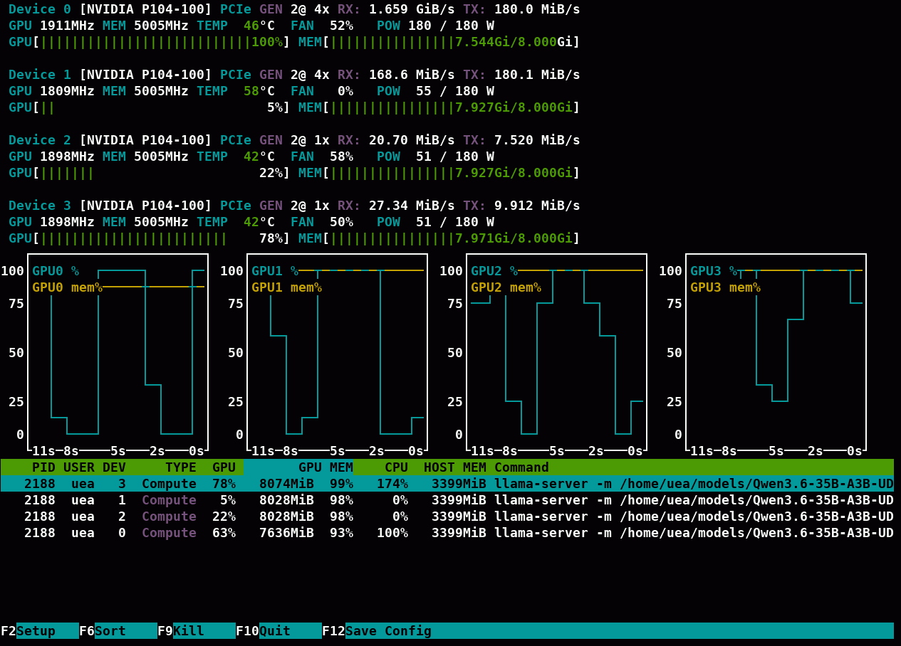

# P104-100 PCIe Gen2 x4 Enforcer Daemon (Linux)

A native Linux background daemon that unlocks **PCIe Gen2 x4** on NVIDIA
**P104-100** mining GPUs (`10DE:1B87`) and keeps the link at Gen2 even when the
NVIDIA driver, a power-state transition or a bus reset drops it back to Gen1.

**Multi-GPU stability:** When multiple GPUs are present, the daemon handles
them sequentially. The daemon also inserts a configurable delay between cards
(stagger) so that link initialization does not overload the PCIe root ports.

The daemon uses only the Python 3 standard library and talks to hardware
through standard Linux interfaces:

| Resource | Linux interface |
|---|---|
| GPU discovery | `/sys/bus/pci/devices/*/vendor` and `.../device` |
| PCI configuration space | `/sys/bus/pci/devices/<BDF>/config` |
| GPU BAR0 MMIO registers | `/sys/bus/pci/devices/<BDF>/resource0` (mmap) |

No out-of-tree kernel module, no BYOVD driver and no external Python package
is required. Only **volatile** registers are written; a reboot or power cycle
restores the factory state.

## Measured results

### Test configuration

**Hardware:** AMD Phenom(tm) II X4 965 Processor (AM3), MSI 970A-G46, 12 GB
DDR3 (measured 3.54 GB/s), 4× NVIDIA P104-100 (two cards at x4, two at x1).

**Software:** Debian 13 (kernel 6.12.117+deb13-amd64), NVIDIA driver 550.163.01.

| Direction | Gen1 (before) | Gen2 (after) |
|---|---|---|
| Host → Device | 0.74 GB/s | 1.48 GB/s |
| Device → Host | 0.84 GB/s | 1.70 GB/s |

Measured with `nvbandwidth` (`host_to_device_memcpy_ce` and
`device_to_host_memcpy_ce`). The two cards on x4 links reach ≈1.48 / 1.70 GB/s;
the two cards limited to x1 reach ≈0.36 / 0.43 GB/s.

<details>
<summary><b>nvbandwidth log</b></summary>

```text
nvbandwidth Version: v0.11.0
Built from Git version: v0.11.0

CUDA Runtime Version: 12.4 (12040)
CUDA Driver Version (API): 12.4 (12040)
Driver Version: 550.163.01

ai-node
Device 0: NVIDIA P104-100 (00000000:01:00)
Device 1: NVIDIA P104-100 (00000000:02:00)
Device 2: NVIDIA P104-100 (00000000:04:00)
Device 3: NVIDIA P104-100 (00000000:07:00)

Running host_to_device_memcpy_ce.
memcpy CE CPU(row) -> GPU(column) bandwidth (GB/s)
           0         1         2         3
 0      1.48      1.49      0.36      0.36

SUM host_to_device_memcpy_ce 3.69
COEFFICIENT_OF_VARIATION host_to_device_memcpy_ce 0.001041

Running device_to_host_memcpy_ce.
memcpy CE CPU(row) <- GPU(column) bandwidth (GB/s)
           0         1         2         3
 0      1.70      1.70      0.43      0.43

SUM device_to_host_memcpy_ce 4.26
COEFFICIENT_OF_VARIATION device_to_host_memcpy_ce 0.000250
```

</details>

The screenshot below shows `nvtop` during `llama.cpp` inference of
Qwen3.6-35B-A3B.

<a href="img/nvtop.png"></a>

## Attribution

This project is a Linux port of the Windows tool **p104-unlock-v3**:

- Original project: <https://github.com/skbskhud/p104-unlock-v3>
- The register recipes, safety rules and measured behaviour come from the
  original author's work and notes.

## How it works

The P104-100 boots with its PCIe capability pinned to Gen1 (`LCAP2 = 0x02`).
The code treats the Gen2 declaration as `(LCAP2 & 0x6) == 0x6`. According to
p104-unlock-v3, the NVIDIA driver
rewrites several volatile BAR0 registers whenever it initialises or wakes the
GPU, which is what causes the link to fall back to Gen1. The daemon applies the
same "live write group" that was measured to work on the original hardware:

```
0x8C040 SPEED[19:18] = 1        (5.0 GT/s)
0x8872C[3:0] = 6
0x2241C |= 0x81
0x8841C &= ~0x6000
0x8C2C0 &= ~0x04
0x8C300 &= ~0x10
0x8C1C0[19:16] = 2              (target link speed Gen2)
0x88610 |= 0x01, clear bit 12
```

The order is significant: `0x8C040` is written first. The daemon does not add
an extra read before `0x8C040`, and it does not reorder or split the steps.

After the group completes, the daemon:

1. Writes `LNKCTL2[3:0] = 2` (target speed Gen2) on **both** the endpoint and
   its upstream root port, skipping a link-control register whose TLS field is
   already `2`.
2. Triggers a link retrain on the root port and on the endpoint, then waits up
   to 4 s for the link to report Gen2. In the one-shot path this runs even if
   the Gen2 declaration did not latch.
3. **Optionally** arms the x16 width declaration with the safe whole-word recipe
   `0x8C040 = (cur & ~0xF8000000) | 0x80000000` — only when ``--x16`` is passed.
4. Retrains once and checks whether the physical width reached x16.

The watchdog then re-checks the link on every polling tick (default 20 ms).
While the link is Gen2 and the declaration is present, it only rewrites
`0x8C040` when the speed field has deviated. If the declaration is lost it
replays the full group (debounced by `--min-gap`). While the link is Gen1 it
disarms an armed x16 declaration, retriggers TLS+retrain every `--retrain-gap`,
and replays the full group after `--group-retry` seconds, so it keeps actively
trying to recover the link.

### Safety rules inherited from the original tool

- `0x8C040` is only ever written as a whole 32-bit word. The ordinary speed
  update changes only `SPEED[19:18]` and preserves bits 31 and 29; the x16 arm
  path builds the word with bit31 = 1 and bit29 = 0 (the value is constructed
  as `(cur & ~0xF8000000) | 0x80000000` which clears bits 27–31 then sets
  bit31, leaving bit29 = 0). The original tool observed that writing both
  bit31 = 0 and bit29 = 0 can knock the card off the bus; the daemon checks
  this condition with an `Is8C040Legal()` guard (`bit31 || bit29` must be true)
  and refuses any write that would set both to 0. Writing both bits to 1 is
  also known to be dangerous (1/1 observed case in the C# reference), but the
  daemon does not prevent this combination explicitly.
- To roll back an armed width declaration, the **whole word**
  `0x8C040 = 0x20085800` is written. Bit31 is never cleared with a mask.
- The daemon discovers only devices whose sysfs IDs are exactly `10DE:1B87`
  and re-checks the vendor/device ID before each write group. Non-target
  hardware is never touched.
- The daemon reads the upstream root port's PCIe capability to set `LNKCTL2`
  and to trigger the retrain, but it does **not** verify the root port's
  maximum link speed. If the root port is Gen1-only, the unlock simply fails
  instead of being refused up front.
- Any configuration-space or BAR0 read that returns all ones (`0xFFFFFFFF` /
  `0xFFFF`) is treated as "device gone". The daemon does not report a false
  `PASS` and aborts the current operation; the watchdog may retry or remap the
  device instead of exiting.
- The Linux port does **not** perform a PCI hot-reset. If the card ever drops
  off the bus, reboot the machine (power-cycle it only if a reboot is not
  enough). This has not been observed with the current version.
- BAR0 is mapped while the NVIDIA driver is bound. This is the same approach
  as the original tool but is not an officially supported kernel use case;
  keep backups and use it on a machine you can safely power-cycle.

### x16 width declaration vs. physical x16

The x16 width declaration is **disabled by default**. The ``--x16`` flag sets
the bus width declaration to 16 lanes (`LnkCap maxwidth = 16`). The tool
retrains the link, but the physical width stays at x4 — tested directly on
the card and confirmed: adding AC coupling capacitors does not enable x16
mode.

To enable the x16 width declaration, pass ``--x16``:

```bash
sudo python3 /usr/local/p104-100/p104-100.py --once --x16
```

The daemon logs the actual `LNKSTA` width and stops retraining after two
consecutive misses in the same process.

## Requirements

- Linux with sysfs PCI support (any modern distribution).
- Python 3.9 or newer.
- Root privileges (raw PCI configuration-space and BAR0 access).
- The NVIDIA driver loaded with the Gen2 driver policy enabled
  (`RmForceEnableGen2=1`, `RMPcieLinkSpeed=0x1`); see
  [NVIDIA driver policy](#nvidia-driver-policy-gen2-enable). The daemon does
  not require `nvidia-smi`, but the driver must have bound the GPU for the
  link to be initialised.
- An x86_64 host is recommended. The code handles non-4 KiB page sizes, but
  the register map was verified on x86_64.
- Kernel BAR0 access: kernels built with `CONFIG_IO_STRICT_DEVMEM` (the
  default on Ubuntu and many other distributions) refuse `mmap()` of
  `resource0` while the NVIDIA driver has claimed the BAR. Add
  `iomem=relaxed` to the kernel command line; see
  [Kernel access to BAR0](#kernel-access-to-bar0-iomemrelaxed) below.

## Kernel access to BAR0 (`iomem=relaxed`)

Since Linux 5.12 (commit `636b21b50152`, "PCI: Revoke mappings like devmem"),
kernels with `CONFIG_IO_STRICT_DEVMEM=y` reject user-space mappings of a sysfs
PCI resource whose region is already owned by a kernel driver. On such a
system the daemon fails with an error such as:

```
0000:01:00.0: [Errno 22] Invalid argument
```

even when run as root, because the NVIDIA driver has requested the BAR. The
supported way to allow the daemon to map it is to boot with the kernel
parameter `iomem=relaxed`:

```bash
# GRUB-based distributions (Debian, Ubuntu, Arch, Fedora)
# Add iomem=relaxed to GRUB_CMDLINE_LINUX_DEFAULT in /etc/default/grub, e.g.:
#   GRUB_CMDLINE_LINUX_DEFAULT="quiet splash iomem=relaxed"
sudo update-grub
sudo reboot
```

For systemd-boot or a custom bootloader, append `iomem=relaxed` to the kernel
`options`/`linux` line instead. After reboot, verify it is active:

```bash
grep -o 'iomem=relaxed' /proc/cmdline
```

`iomem=relaxed` is machine-wide: it also relaxes `/dev/mem` filtering for
other devices, so treat it as a **deliberate security trade-off**. It does not
unprotect system RAM, and it does not bypass Secure Boot or kernel lockdown.
If Secure Boot/lockdown is enabled, the mmap can still fail with `EPERM`;
disable Secure Boot or use a kernel without lockdown for this machine.

If the mmap fails with `EINVAL`, boot with `iomem=relaxed` as described above.
If it fails with `EPERM`, disable Secure Boot/kernel lockdown instead; the
`iomem=relaxed` parameter does not bypass lockdown.

## NVIDIA driver policy (Gen2 enable)

The Windows original writes the display driver's registry policy before every
unlock:

```
RMPcieLinkSpeed = 1
RmForceEnableGen2 = 1
RmEnableGen2 = 1
```

On Linux the same settings are passed to the proprietary NVIDIA module through
`NVreg_RegistryDwords`. Without them the driver may keep clamping the PCIe
link to Gen1 and can undo or fight the BAR0 declaration. Create
`/etc/modprobe.d/p104-100.conf`:

```bash
echo 'options nvidia NVreg_RegistryDwords="RmForceEnableGen2=1;RMPcieLinkSpeed=0x1;RmEnableGen2=1"' \
  | sudo tee /etc/modprobe.d/p104-100.conf
sudo update-initramfs -u
sudo reboot
```

Verify after reboot:

```bash
grep RegistryDwords /proc/driver/nvidia/params
```

The daemon does not verify this policy at startup.

> **Warning:** these registry dwords are global and affect **every** NVIDIA
> GPU in the machine (they tell the driver to allow Gen2). On a mixed rig with
> newer cards, use `NVreg_RegistryDwordsPerDevice="pci=0000:01:00.0;..."` if
> your driver version supports these keys per device, or accept that all GPUs
> will be allowed to negotiate Gen2.

## Installation

1. Copy the daemon to a stable location:

   ```bash
   sudo install -d -m 0755 /usr/local/p104-100
   sudo install -m 0755 p104-100.py /usr/local/p104-100/p104-100.py
   ```

2. Verify the current link state (read-only):

   ```bash
   sudo python3 /usr/local/p104-100/p104-100.py --status
   ```

   On the test hardware, a factory card reports `LNKSTA=0x0041`
   (`2.5GT/s (Gen1) x4`).

3. Try a single unlock before installing the service:

   ```bash
   sudo python3 /usr/local/p104-100/p104-100.py --once --bdf 0000:01:00.0
   ```

   The daemon logs a `PASS` line (add `--log-level DEBUG` for group steps).
   Re-run `--status` to confirm Gen2.

4. Install and start the systemd service:

   ```bash
   sudo install -m 0644 p104-100.service /etc/systemd/system/p104-100.service
   sudo systemctl daemon-reload
   sudo systemctl enable --now p104-100.service
   ```

## Running and monitoring

```bash
# Service status and recent log lines
systemctl status p104-100.service
journalctl -u p104-100.service -f

# Follow the structured log
journalctl -u p104-100.service -n 100 --no-pager

# Current link state (read-only)
sudo python3 /usr/local/p104-100/p104-100.py --status
```

The default `INFO` level shows card discovery, the first Gen2 confirmation per
card, lifecycle messages (signals and watchdog shutdown), `PASS` lines in
`--once`, x16 announcements when `--x16` is used, and problems (a link that
stays below Gen2, MMIO/config-space errors). Gen2 retrains and recoveries are
logged at `DEBUG`; use `--log-level DEBUG` to see the full per-step register
and retrain trace.

Typical successful log lines:

```
2026-11-15 05:40:13 INFO     found 4 P104-100 card(s): 0000:01:00.0, ...
2026-11-15 05:40:13 INFO     0000:01:00.0: Gen2 active (5.0GT/s (Gen2) x4)
```

## Configuration

All options are command-line flags. Edit `ExecStart` in the unit file to change
the defaults.

| Option | Default | Description |
|---|---|---|
| `--interval SECONDS` | `0.02` | Hold-loop tick. `0.02` is the 20 ms tick copied from the C# `HoldLoop`. |
| `--min-gap SECONDS` | `0.2` | Debounce between full-group replays. |
| `--retrain-gap SECONDS` | `0.02` | Debounce between TLS+retrain triggers while the link is Gen1. |
| `--speed-gap SECONDS` | `0.2` | Debounce between fast `0x8C040` speed rewrites. |
| `--group-retry SECONDS` | `6` | Replay the full group after this long in Gen1. |
| `--x16` | off | Arm the x16 width declaration on the bus (announcement only). |
| `--once` | off | Apply the full unlock once and exit. |
| `--status` | off | Print the current link state of every P104-100 and exit. |
| `--bdf BDF` | all | Only operate on this PCI address (repeatable). |
| `--force` | off | Bypass the single-instance lock (unsafe; concurrent instances can corrupt the link state). |
| `--stagger SECONDS` | `1.0` | Delay between cards during `--once` only. |
| `--log-level LEVEL` | `INFO` | `DEBUG`, `INFO`, `WARNING` or `ERROR`. |

Examples:

```bash
# Watchdog with the 20 ms hold loop (default)
sudo python3 /usr/local/p104-100/p104-100.py

# One-shot unlock of a single card
sudo python3 /usr/local/p104-100/p104-100.py --once --bdf 0000:01:00.0

# x16 width declaration (announcement only)
sudo python3 /usr/local/p104-100/p104-100.py --once --x16 --bdf 0000:01:00.0

# Retry the full group less often on a noisy link
sudo python3 /usr/local/p104-100/p104-100.py --group-retry 10

# One-shot diagnostic
sudo python3 /usr/local/p104-100/p104-100.py --once --log-level DEBUG --bdf 0000:01:00.0
```

## Multi-GPU systems

The daemon discovers all P104-100 cards at startup and keeps one instance per
card. Each tick (20 ms by default) visits the cards sequentially and configures
only the two ends of that card's link. New cards are not hot-added; restart the
service after changing the hardware.

Initializing several cards at once can overload the PCIe root ports, so
`--once` staggers the full-group unlock between cards (`--stagger`, default
1 s). The watchdog itself does not stagger: it polls each card on every tick
and may perform speed writes, TLS+retrain, a full-group replay, or a BAR0
remap when needed.

**Recommended settings for a 4-card rig:**

- `--interval 0.02` (20 ms tick; this is the default)
- no `--x16` unless you want the bus width announcement
- validate `--once --bdf <addr>` on one card before running the watchdog on
  all four

## Single instance

The watchdog and `--once` take an exclusive `flock` on
`/run/lock/p104-100.lock`. A second writer exits with code `3` and logs
the PID of the running instance; the lock is released automatically on exit or
crash. `--status` is read-only and never takes the lock. Use `--force` only to
override the lock intentionally.

## systemd unit notes

The provided `p104-100.service` is intentionally hardened:

- Runs as `root` with a minimal capability bounding set
  (`CAP_SYS_ADMIN`, `CAP_SYS_RAWIO`).
- `ProtectSystem=strict`, `ProtectHome=yes`, `PrivateTmp=yes`,
  `PrivateDevices=yes`, `NoNewPrivileges=yes`, `MemoryDenyWriteExecute=yes`,
  `RestrictAddressFamilies=AF_UNIX`.
- `ProtectKernelTunables=no` is **required**. Enabling it remounts `/sys`
  read-only and would prevent PCI configuration-space writes.

If your distribution starts the service before the NVIDIA driver is ready,
increase `RestartSec` or add a suitable `After=` dependency. If no card is
found at startup the daemon exits with code 4 and systemd restarts it.
`RestartPreventExitStatus=3` stops the restart loop when another instance
already holds the lock; stop that instance and restart the unit manually.

## Troubleshooting

| Symptom | Likely cause / fix |
|---|---|
| `no NVIDIA P104-100 (10DE:1B87) found` | The GPU is not visible in `lspci`; check `lspci -nn | grep 10de`, the driver and the power cabling. |
| Config-space writes fail (`EPERM`, `EACCES`, `EIO`, ...) | Run as root. Check `ls -l /sys/bus/pci/devices/<BDF>/config` and the kernel log. |
| Writes fail with `EPERM` even as root | Kernel lockdown (Secure Boot) blocks userspace PCI config access (`LOCKDOWN_PCI_ACCESS`). Disable Secure Boot or kernel lockdown for this machine. |
| `cannot open: ...` or a `resource0` error | BAR0 is not assigned or the resource is unavailable. Check `lspci -vv` and the kernel log. |
| `[Errno 22] Invalid argument` while mapping `resource0` | The kernel blocks user-space mappings of a driver-owned BAR (`CONFIG_IO_STRICT_DEVMEM`). Boot with `iomem=relaxed`; see [Kernel access to BAR0](#kernel-access-to-bar0-iomemrelaxed). |
| `[Errno 1] Operation not permitted` while mapping `resource0` | Kernel lockdown (Secure Boot) or an LSM (AppArmor/SELinux) blocked the mapping. Disable Secure Boot/kernel lockdown. |
| Gen2 declaration is present but the link stays Gen1 | Check the log with `--log-level DEBUG`; the card or slot may not support Gen2. The daemon already retrains the root port, so try `--interval 0.02` and verify the root port's `LnkCap`. |
| `FAIL - still ...` after all retries | The card or slot may not support Gen2 on this platform, or the link partner is a PCH port. |
| Gen2 is not retained after the driver loads | The `NVreg_RegistryDwords` policy may be missing. Add it as described in [NVIDIA driver policy](#nvidia-driver-policy-gen2-enable) and reboot. |
| Gen2 never appears and the root port is Gen1-only | The daemon does not pre-check the root port, so the unlock simply fails. Move the GPU to a Gen2-capable slot/riser. |
| `config space is gone after unlock`, `read 0xFFFFFFFF -> link is down`, `link dropped during ...`, or `NVRM: Xid ... GPU has fallen off the bus` | The GPU stopped responding to PCIe access, so the daemon aborts instead of writing more registers or reporting a false `PASS`. Reboot the machine; if the card does not return, power off and boot again, then check the upstream port's `LnkCap` and the riser/slot. |
| Link drops during CUDA work | Expected. The NVIDIA driver rewrites the volatile registers; the daemon restores Gen2 on the next poll (20 ms tick by default). |
| Card disappeared from the bus | This has not been observed. If it ever happens, a normal reboot is enough; if the card does not return, power off and boot again. |

## Uninstall

```bash
sudo systemctl disable --now p104-100.service
sudo rm -f /etc/systemd/system/p104-100.service
sudo systemctl daemon-reload
sudo rm -rf /usr/local/p104-100
```

A reboot (or power cycle) is enough to revert all register changes. The daemon
never modifies the VBIOS, EEPROM or fuses.

## Disclaimer

For learning, research and your own hardware only. Modifying PCIe link
configuration can cause device loss or system instability. Use at your own
risk. No VBIOS, EEPROM or fuse-level persistent changes are made; all writes
target volatile registers and disappear after a reboot or power cycle.

This project is not affiliated with NVIDIA or with the original author of
`p104-unlock-v3`; it is an independent Linux port published under the same
spirit of open research.

This software is provided "as is", without warranty of any kind, and is
distributed under the terms of the [MIT License](LICENSE).
